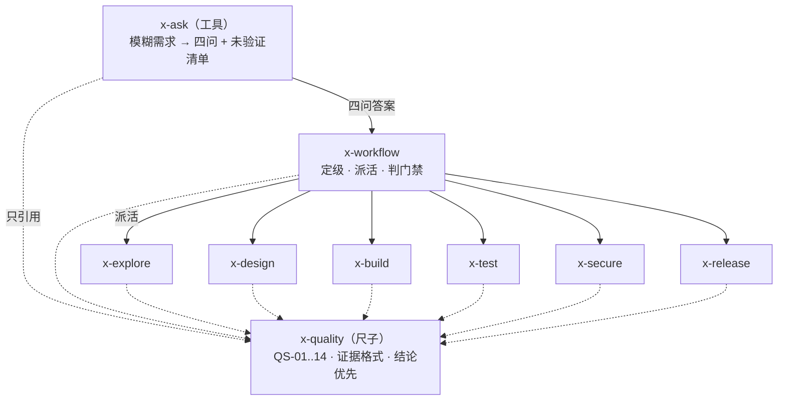

# workflow-skill — 多角色研发工作流

八个角色 skill，覆盖从"看懂代码"到"安全上线"的完整链路；外加一个不参与链路的工具 `x-ask`，把模糊需求问成能判定的四问。链路的核心只有一条：**上一环的门禁没过，下一环不许开工。**

## 结构

```
workflow-skill/
├── x-workflow/ 编排入口：变更分级 + 7 道门禁 + 交接物契约   beta
├── x-quality/  质量宪法：QS-01..QS-14，dev 自检与 review 复核共用
├── x-explore/  探索者：只报告不设计，结论必须带 file:line   beta
├── x-design/   架构师：≥2 方案对比 + 不建清单 + 不可逆决策 ADR
├── x-build/    开发者：垂直切片 TDD + 逐条自检              beta
├── x-test/     测试：验收标准映射 + 边界错误路径 + 证据
├── x-secure/   安全：无攻击路径不给级别
├── x-release/  发布：影响面 + 放大效应 + 双类信号 + 回滚    beta
├── x-ask/      工具：把模糊需求问成四问，不参与链路
└── scripts/    gate-check.py：把门禁变成可执行检查 + 自测
```

`beta` = 没通过对抗探针——要么没做过，要么做过但还有未修的失败项。见文末「已知的待验证项」。

`x-ask` 是唯一不在链路上的 skill：它不知道产物叫什么、也不知道门禁编号，所以能用在任何模糊输入上，包括不属于软件开发的。

## 调用关系

谁可以调谁。实线 = 派活，虚线 = 引用（不是调用）。



**禁止的方向**（后两条由 `CONSISTENCY.md` 第五节的脚本校验，前两条靠人工复查）：

- 角色之间不许互相引用职责。「这个交给 `x-secure` 判断」可以，「`x-secure` 应该做 X」不行。
- `x-quality` 不许引用任何 skill。尺子一旦认识某个角色，就不能被别的角色用。
- `x-ask` 不许引用角色名、产物名、门禁 ID。工具一旦知道自己在哪条链路里，就只能在那条链路里用。
- 除了 `x-workflow`，没有第二个入口。

依赖方向的唯一真相在 [`CONSISTENCY.md`](CONSISTENCY.md) 第二节；本图是它的可视化，两边不一致以那里为准。

## 工作流

```
00-brief ──G0──> 01-explore ──G1──> 02-design ──G2──┬─> 03-impl ──G3──┐
                                                     ├─> 04-test ──G4──┼──> 06-release ──G6
                                                     └─> 05-sec  ──G5──┘
```

## 安装

clone 或下载后，把目录整体拷进你的 agent 技能目录：

```bash
cp -r workflow-skill/x-*/ ~/.config/opencode/skills/   # 只拷 skill 目录，scripts/ 不拷；路径按你的工具改
```

不绑定工具：任何能读 Markdown 的 agent 都能用。也可以只放一个 `x-quality`，当项目的质量宪法（阈值可按项目改）。

## 使用方法

### 一句话启动

```
使用 x-workflow 处理：给 /api/orders 加一个限流中间件，按用户维度 100 次/分钟
```

它会先定级、说明要走哪些角色和门禁，然后才动手。**第一次输出里没有代码是正常的**——代码出现在分级结果之前，说明 G0 没过。

### 它怎么定级

| 级别 | 什么情况 | 走哪些环节 | 你要准备 |
|---|---|---|---|
| L0 微改 | 不改行为、不改契约、≤1 处（拼写、单行修复、纯注释格式） | 直接做，但必须贴证据 | 无 |
| L1 单模块 | 1 个文件或函数内，契约不变 | build → test | 验收标准 |
| L2 跨模块 | 改契约，或 ≥2 个模块，或上线行为变化 | explore → design → build ∥ test ∥ secure → release | 验收标准 + 边界 |
| L3 不可逆 | 数据迁移、新服务、权限 / 计费 / 资金路径 | 全链路 + ADR + 分阶段发布 + 回滚演练 | 上面的全部 + 变更窗口 |

定错等级的代价是对称的：L2 当 L1 做 → 上线后才发现契约被破坏；L1 当 L3 做 → 流程形式化，团队开始绕过流程。

### 三段主线：分析 → 设计 → 开发

每一段都有产物、有门禁，没过不进下一环。

**① 分析** — `x-explore`

| | |
|---|---|
| 你给 | 需求 + 要读的目录范围 |
| 它给 | `01-explore.md`：入口与调用链、契约清单、惯例判定、风险面、未知项 |
| 你验 | 每个结论带 `文件:行 → 原文`。没有行号的结论就是猜测 |
| 它不做 | 不提方案、不改文件。它给的是地图，不是建议 |

**② 设计** — `x-design`

| | |
|---|---|
| 你给 | 上一步的 `01-explore.md` |
| 它给 | `02-design.md`：≥2 方案对比 + 淘汰理由、接缝与接口、失败模式、**不建清单**、ADR |
| 你验 | 不建清单不能为空；"不够优雅"不算淘汰理由；每个抽象有 ≥2 个当前消费者 |
| 它不做 | 不写实现代码（签名 ≤5 行）、不做"以后可能需要"的扩展 |

**③ 开发** — `x-build` + `x-test`（+ `x-secure` 并行）

| | |
|---|---|
| 你给 | 批准的设计 |
| 它给 | 代码 + `03-impl.md`（红→绿切片记录、14 条 QS 自检）+ `04-test.md` |
| 你验 | 有红→绿记录，不是只有最终绿；QS 结论带证据，不是"已检查"三个字 |
| 它不做 | 不给自己签 G3、不顺手重构、不改测试迁就实现 |

### 产物落在哪

```
.engineering/<change-id>/
├── 00-brief.md     需求唯一真相：目标、验收标准、不做什么、分级
├── 01-explore.md   现状测绘
├── 02-design.md    方案与接缝
├── 03-impl.md      改动、切片、QS 自检
├── 04-test.md      映射、边界、证据
├── 05-security.md  信任边界、发现
└── 06-release.md   影响面、信号、回滚、runbook
```

文件名固定，不改名不合并。`00-brief.md` 是唯一的需求真相——任何角色对需求的疑问只能来自这里；这里没有的，回到 G0 补，不许各自发明。

### 被打回怎么办

门禁只有两种结果：**PASS**，或 **FAIL + 具体条目**（G 编号 + 哪条不满足）。

- 只改被点名的条目，不要重写整篇
- 改完重新提交，门禁重跑
- 出现"基本通过""大体没问题" → 门禁已失效，要求它给出 G 编号和证据

### 不必走全流程

skill 是独立可用的，全流程只是把它们串起来：

| 你想干的事 | 直接调 |
|---|---|
| 需求还很模糊，说不清怎么算做完 | `x-ask` |
| 搞懂一块陌生代码 | `x-explore` |
| 让方案被挑战一次 | `x-design` |
| 检查代码质量 | `x-quality` |
| 上线前过一遍风险 | `x-release` |
| 做威胁建模 | `x-secure` |

## 门禁可执行检查

门禁不只有文字。`scripts/gate-check.py` 直接读产物目录判 PASS / FAIL：

```bash
python3 scripts/gate-check.py .engineering/<change-id>
```

它只查**能机械判定的那部分**：

| 检查 | 拦什么 |
|---|---|
| 产物顺序 | 有 `02-design.md` 却没有 `01-explore.md`；有 `04-test.md` 却没有 `03-impl.md` |
| G0 | `00-brief.md` 缺 目标 / 验收标准 / 不做什么 / 分级，或没有任何 `AC-n` 编号 |
| G2 | 不建清单为空；方案对比不足 2 个；决策为空 |
| G4 | `04-test.md` 漏掉 `00-brief.md` 里的某条 `AC-n` |
| G6 | 回滚写成"观察一下"；信号没有任何带数值的阈值 |
| 措辞 | 出现"基本通过""大体没问题""应该可以""差不多" |
| `produced-by` | 产物首行不是 `produced-by: <session-id>`；`01`/`02`/`03` 用了同一个 id——「自审不算」靠这个才可验 |

它**判不了语义**：拦不住"方案对比是凑数的"，只拦得住"根本没写"。所以它是门禁的下限，不是门禁的全部。

`scripts/selftest-gate-check.sh` 用 9 个 fixture（1 个正确 + 8 个故意破坏）证明这个脚本会咬人——一个从来没失败过的检查不算检查：

```bash
bash scripts/selftest-gate-check.sh   # 期望 SELFTEST: PASS
```

## 设计取舍

- **语言无关**：不绑定具体工具命令。机械层写成"项目自带检查零新增告警"，没有工具时按判定方法人工判，并注明"无工具，人工判定"。
- **证据格式统一**：`命令 → 输出`、`文件:行 → 原文`、`未验证：<缺什么>` 三种，所有 skill 共用一份定义（在 `x-quality`）。禁止只写结论、只写来源、或用 `[A]/[B]/[C]` 这类需要图例的代号。
- **结论优先**：正文只写 `A → C`，中间环节 B 降级为证据。报告长度由结论数量决定，不由工作步骤数量决定。调用链、攻击路径、回滚步骤属于交付物，不适用压缩。
- **门禁只有 PASS / FAIL + 条目**：杜绝"基本通过"。
- **自审不算**：写代码的人不能签自己的门禁；同一上下文里既写实现又写测试 = 没测。
- **角色可替换，门禁不可省**：`x-workflow` 末尾列了本机可复用的现成资产（explore / oracle / security-research / tdd 等），挂哪个工具随意，门禁不许删。

## 维护

改动任一 skill 之前先读 [`CONSISTENCY.md`](CONSISTENCY.md)。所有 skill 共享的定义（证据格式 / 结论优先 / 门禁 ID / 产物名 / QS 编号 / maturity）只能有一处真相，改一处要按影响矩阵复查其余。改完跑两件事：`CONSISTENCY.md` 第五节的校验脚本，和 `bash scripts/selftest-gate-check.sh`。

## 已知的待验证项

- 已做 17 次对抗探针，覆盖 `x-quality`（5）、`x-ask`（7）、`x-secure`（1）、`x-test`（1）、`x-design`（1）、QS-01 死代码判定（2）。`x-workflow`、`x-explore`、`x-build`、`x-release` 没有探针。
- `x-ask` 有 7 条探针，其中 D/E 是同一 fixture 的前后对照：加「先对一次前提」后，它从「把质疑塞在 Q3」变成「第一句就顶回前提并给出替代动作」。修完终止条件后，B 里越界的两个问题（测试框架、日志落点）消失了。残留：第二轮边界仍模糊，C′ 有一个问题（429 响应体）越界。
- 每个 skill 的 frontmatter 用 `metadata.maturity` 标证据等级：`probed` = 通过探针，`beta` = 未通过。标 `beta` 的就是 `x-workflow`、`x-explore`、`x-build`、`x-release`，与上一条必须一致，由 `CONSISTENCY.md` 第五节的脚本校验。
- 探针把 skill 正文直接注入子代理执行，未验证 `description` 字段能否让真实会话自动加载到对应 skill。
- 多数探针只有「条款被遵守」一条判据，没有对照组。`x-ask` 的 D/E 是第一次前后对照（同一 fixture、同一模型，只换 skill 正文），但它只覆盖一条条款、一个案例，不能说明条款普遍有效。
- `scripts/gate-check.py` 只查结构与非空，判不了语义好坏。它证明的是"没写"会被拦住，不是"写得对"。
- 首次真实使用后，应按实际被绕过的条款补「借口与回应」表。
